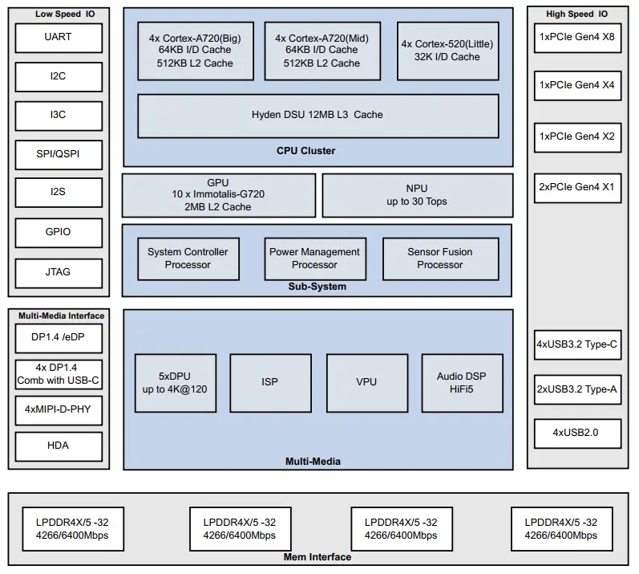

# CD8180 / CD8160 / P1

## General Specifications
{}



>[!NOTE]
>Every Cix P1 has been limited up to 2.6GHz afterwards while the original target was 2.8GHz

{}
 
{}

{}

---

## Linux Support

### Mainline kernel
- [ ] Fully supported.
- [x] Works but not all features are implemented.
- Driver support status available [here](https://github.com/cixtech/linux-mainline/wiki)

---

## Available OS
- [Ubuntu Concept](https://discourse.ubuntu.com/t/ubuntu-concept-goes-cix-p1/82213)
- Vendor Releases (see board page)

---

## Boards with Cix P1

List of boards:

 

- Minisforum MS-R1
- Radxa Orion O6N
- OrangePi 6 Plus
- MetaComputing ARM AI PC

---

## What variant is CD8160?

> “CD8160 was the silkscreen used in early mass production. As PC/server models entered production, all silkscreen numbers were standardized to C*8180. CD8160 is no longer supplied.”

Cix P1 variants like CD8160 are all the same SoC from different batches in production. There are **no differences**.
